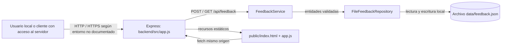

# Informe de seguridad — Customer Feedback Service

**Fase:** seguridad — Revisión de seguridad  
**Fecha de revisión documental:** 2026-10-06  
**Alcance:** backend, frontend, contrato API, persistencia local y pruebas declaradas.  
**Estado:** revisión estática/documental; no constituye un escaneo, una prueba de penetración, una certificación ni evidencia de ejecución de build o pruebas.

## 1. Alcance, fuentes y limitaciones

### Fuentes revisadas

| Área | Archivos considerados |
|---|---|
| Requisitos y decisiones | `analisis/analisis.md`, `diseno/diseno.md`, `planificacion/plan.md` |
| Contrato | `contrato-api/api-contract.md`, `backend/contrato-api/api-contract.md` |
| Backend | `backend/src/app.js`, `backend/src/server.js`, `backend/src/domain/feedback.js`, `backend/src/services/feedback-service.js`, `backend/src/repositories/file-feedback-repository.js` |
| Frontend | `backend/public/index.html`, `backend/public/app.js`, `backend/public/feedback-client.js`, `backend/public/styles.css` |
| Configuración | `backend/package.json`, `backend/.gitignore`, `backend/playwright.config.js` |
| Cobertura declarada | `backend/tests/**/*.test.js`, `backend/e2e/feedback.spec.js`, `generacion-tests/backend/**/*.test.js`, `generacion-tests/backend/TESTING.md` |
| Evidencia de verificación previa | `compilacion/compilacion.md`, `tests-unitarios/unit-tests.md`, `tests-integracion/integration-tests.md`, `tests-e2e/e2e.md` |

Se toma `backend/` como implementación principal, ya que es la ubicación documentada por `generacion-tests/backend/TESTING.md`. Existen copias de fuentes bajo `frontend/backend/` e `integracion/backend/`; no se evalúan como instancias desplegadas independientes.

### Restricciones conservadas

- La aplicación debe ser pequeña y ejecutable localmente.
- No debe incorporar autenticación, autorización, sesiones, JWT, usuarios, cloud, integraciones ni servicios externos.
- La ruta `/admin` es una capacidad funcional de revisión, no una zona protegida por identidad.
- La persistencia se realiza localmente mediante archivo.

### Limitaciones de la revisión

1. No se proporcionó un entorno en ejecución, configuración de red del host, sistema operativo, permisos reales del directorio de datos, proxy inverso ni configuración de despliegue.
2. No se proporcionó un archivo de bloqueo de dependencias (`package-lock.json`, equivalente) ni inventario SBOM.
3. Los documentos de verificación anteriores indican estado `unavailable` y comprobaciones estructurales; expresamente no acreditan ejecución de build, pruebas unitarias, integración ni E2E.
4. Por estas limitaciones, las conclusiones distinguen entre **evidencia estática**, **inferencia razonable** y **actividad pendiente**.

---

## 2. Criterios aplicados

| Criterio | Versión | Uso en esta revisión |
|---|---|---|
| OWASP Top 10 | **2021** | Clasificación de riesgos según la superficie real: A01 acceso, A02 datos/criptografía, A03 inyección, A04 diseño inseguro, A05 configuración, A06 componentes vulnerables, A07 autenticación, A08 integridad, A09 registro y monitoreo, A10 SSRF. |
| OWASP Application Security Verification Standard (ASVS) | **PR25**, según la guía aportada | Referencia para decidir requisitos verificables de diseño, implementación, pruebas y observabilidad. La guía aportada no especifica una versión final numerada ni identificadores de controles ASVS; por ello no se inventan IDs de requisito. |
| STRIDE | Sin versión aplicable | Modelado de amenazas: suplantación, manipulación, repudio, divulgación, denegación de servicio y elevación de privilegios. |

El nivel ASVS no fue definido por el brief. **Supuesto mínimo:** para una aplicación local que almacena feedback potencialmente sensible y no procesa pagos ni identidad, el objetivo futuro razonable es una línea base equivalente a ASVS Nivel 1, reforzada en controles de validación, manejo de errores, persistencia y exposición de datos. Esta es una recomendación de priorización, no una certificación ni una declaración de cumplimiento.

---

## 3. Superficie, activos y límites de confianza

### Activos

| Activo | Sensibilidad | Motivo |
|---|---|---|
| Mensajes `Feedback.message` | Media a alta | Aunque no se solicitan datos personales, un usuario puede incluir información personal, confidencial o dañina. |
| Archivo local `data/feedback.json` | Alta | Contiene la colección persistida de feedback. |
| Integridad de la colección | Alta | La pérdida, sobrescritura o alteración afecta la revisión funcional. |
| Disponibilidad del servidor y disco local | Media | El servicio acepta creación de entradas y persiste en disco. |
| Integridad del frontend publicado | Alta | Un cambio en `public/app.js` puede afectar las solicitudes y el renderizado. |
| Identificadores y marcas temporales generados por servidor | Media | Previenen que el cliente establezca campos de servidor y determinan orden de revisión. |

### Flujo y límites de confianza

| Límite | Riesgos principales |
|---|---|
| Cliente → API | Payload malformado, asignación masiva, cargas excesivas, abuso de creación, peticiones desde una red no prevista. |
| API → servicio/repository | Persistencia de datos no válidos, errores internos revelados, concurrencia. |
| Repository → sistema de archivos | Exposición local del archivo, corrupción, agotamiento de disco, manipulación por procesos locales. |
| Datos persistidos → frontend | XSS almacenado e indisponibilidad por datos corruptos. |
| Servidor → navegador | Ausencia de cabeceras de protección, cacheo de datos sensibles, framing no deseado. |

---

## 4. Modelo de amenazas STRIDE

| ID | Amenaza | STRIDE | Activo/flujo | Riesgo | Controles observados | Estado |
|---|---|---|---|---|---|---|
| TM-01 | Un tercero con conectividad al servicio consulta `/admin` o `GET /api/feedback`. | S, I | Datos de feedback | Divulgación de todos los mensajes. | No existe autenticación por restricción explícita; documentación lo declara. | Riesgo aceptado por alcance, condicionado a exposición estrictamente local. |
| TM-02 | Contenido de feedback intenta ejecutar JavaScript al mostrarse en revisión. | T, I | Navegador de revisión | XSS almacenado, robo o alteración de contexto del navegador. | `message.textContent = feedback.message` en `backend/public/app.js`; prueba E2E declarada para `` y comprobación de que sólo existe el script legítimo de la aplicación. | `generacion-tests/backend/e2e/feedback.spec.js` | Código de prueba presente; no ejecutado según recibos disponibles. |
| Aislamiento de datos E2E | Eliminación de `data/e2e-feedback.json` antes de suite. | `backend/e2e/global-setup.js` | Código de configuración presente; no ejecutado según recibos disponibles. |

Los documentos `tests-unitarios/unit-tests.md`, `tests-integracion/integration-tests.md` y `tests-e2e/e2e.md` indican que las comprobaciones de toolchain quedaron omitidas. Por tanto, estas pruebas son cobertura **planificada e implementada como código**, no evidencia de resultados satisfactorios.

---

## 11. Actividades pendientes priorizadas

| Prioridad | Actividad | Relación |
|---|---|---|
| P0 | Fijar explícitamente el host loopback de escucha y documentar prohibición de exposición por LAN, túnel o proxy. | SEC-001 |
| P0 | Decidir formalmente si el servicio puede contener feedback sensible. Si la respuesta es sí, aplicar `Cache-Control: no-store` a API y revisión. | SEC-002 |
| P1 | Añadir cabeceras HTTP de protección y pruebas de integración para su presencia. | SEC-002 |
| P1 | Definir límite de colección/archivo, retención y comportamiento al alcanzar la cuota. | SEC-003 |
| P1 | Ejecutar las suites declaradas de unitarias, integración y E2E en un entorno local controlado y conservar recibos de resultados. | Validación de controles existentes |
| P1 | Revisar dependencias con un inventario bloqueado y una herramienta de análisis de vulnerabilidades aplicable a las versiones realmente instaladas. | OWASP A06 |
| P2 | Añadir logging local mínimo, estructurado y sin contenido de feedback. | SEC-004 |
| P2 | Endurecer y comprobar permisos de directorio/archivo de datos en la plataforma objetivo. | SEC-005 |
| P2 | Añadir pruebas de cabeceras de seguridad, no caché, límite de colección y comportamiento de disco lleno/fallo de renombrado. | SEC-002, SEC-003, SEC-005 |

---

## 12. Áreas no verificadas

| Área | Motivo | Actividad necesaria |
|---|---|---|
| Vulnerabilidades conocidas de dependencias directas y transitivas | Falta lockfile, árbol instalado y herramienta de análisis. No se infieren CVEs de los nombres o rangos de dependencias. | Generar SBOM o lockfile y revisar versiones instaladas con análisis aplicable. |
| Ejecución efectiva de pruebas | Los recibos disponibles son estructurales y reportan actividad pendiente. | Ejecutar las suites declaradas y registrar resultados. |
| Exposición de red real | No hay entorno, host OS, firewall, Docker, proxy ni túnel documentados. | Comprobar interfaces de escucha y políticas de red en el entorno local objetivo. |
| HTTPS/transporte | El proyecto documenta HTTP local; no existe configuración TLS revisable. | Determinar si el uso permanece en loopback. Si se expone fuera de loopback, exigir TLS y revisar su configuración. |
| Permisos efectivos del filesystem | Los permisos dependen de SO, umask, existencia previa de archivos y propietario del proceso. | Verificar permisos del directorio y archivo reales en la plataforma objetivo. |
| Corrupción y recuperación del archivo | El repositorio detecta JSON no arreglo, pero no existe estrategia de backup, reparación o recuperación revisada. | Definir runbook local y pruebas de archivo truncado/corrupto. |
| Concurrencia entre procesos | La cola `#writeQueue` cubre un proceso, no varios procesos que apunten al mismo archivo. | Mantener proceso único documentado o introducir bloqueo/almacenamiento apropiado tras ampliar alcance. |
| Cabeceras finales después de proxy | No existe proxy configurado en fuentes. | Revisar respuesta HTTP final si se añade proxy, túnel o servidor local adicional. |
| Accesibilidad automatizada completa | No se observa dependencia axe ni informe de auditoría. | Añadir auditoría compatible si se aprueba y ejecutar la suite correspondiente. |

---

## 13. Conclusión

La implementación revisada incluye controles sólidos y proporcionales contra los riesgos principales de entrada y renderizado: validación autoritativa, límite de cuerpo, rechazo de propiedades adicionales, generación de campos de servidor, errores API sin detalles internos y representación del feedback como texto mediante `textContent`. Estos controles abordan de manera directa XSS almacenado, asignación masiva y persistencia de payloads inválidos.

El riesgo dominante es la **ausencia deliberada de autenticación** para la revisión y la API. Esta condición sólo es aceptable bajo el requisito de operación estrictamente local y confiable; debe compensarse con una escucha explícita en loopback, prohibición documentada de exposición de red y protección de datos en el navegador mediante directivas de no caché. También deben resolverse los límites de crecimiento del archivo, la instrumentación de eventos de seguridad y los permisos efectivos del almacenamiento.

No se declara cumplimiento ASVS, certificación OWASP, análisis de dependencias, ejecución de pruebas ni ausencia absoluta de vulnerabilidades. Las verificaciones pendientes de la sección 11 son necesarias antes de considerar el riesgo residual aceptable para uso local.
